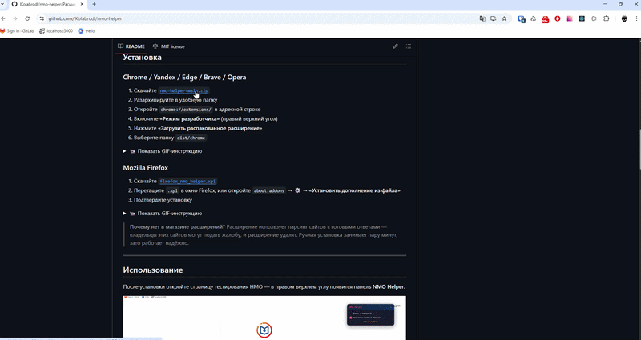
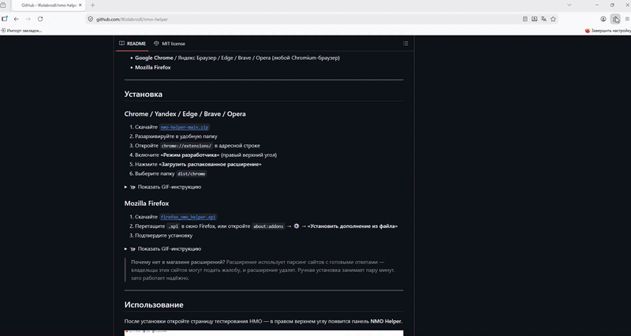

# NMO Helper v5.1.0

> Умный помощник в прохождении тестов НМО — бесплатное расширение для браузера с открытым исходным кодом.

Расширение помогает проходить тесты на портале НМО [edu.rosminzdrav.ru](http://edu.rosminzdrav.ru/).

Авто-поиск по базам ответов, автоответ с настраиваемым интервалом, AI-режим (GPT, Gemini, Claude, DeepSeek), PDF-режим: поиск по клиническим рекомендациям — всё работает из коробки.

[](https://addons.mozilla.org/ru/firefox/addon/nmo-helper/)
[](https://github.com/lKolabrodl/nmo-helper/releases)
[](https://github.com/lKolabrodl/nmo-helper)
[](https://github.com/lKolabrodl/nmo-helper/blob/main/LICENSE)
[](https://www.virustotal.com/gui/file/731e7b2e8170f23bbee990ab8563014f7ce31682b5feeeb22086bdc78ad96865?nocache=1)

🌐 **Сайт:** [nmo-helper.ru](https://nmo-helper.ru)<br>
📖 **Инструкция:** [nmo-helper.ru/instruction](https://nmo-helper.ru/instruction)<br>
💬 **Обратная связь:** [nmo-helper.ru/feedback](https://nmo-helper.ru/feedback)<br>
🐞 **Баги и предложения:** [GitHub Issues](https://github.com/lKolabrodl/nmo-helper/issues)

## Возможности

| Функция | Описание |
|---|---|
| **Авто-поиск** | Автоматически находит тему теста и ищет её в базах ответов |
| **Просмотр вопросов** | Показывает уже загруженные порталом вопросы до старта теста и сохраняет их в TXT |
| **AI-режим** | Решает тесты бесплатными моделями без ключа либо через ProxyAPI / свой endpoint |
| **Общая база NMO Helper** | Ищет ответы в собственной базе; завершённым тестом можно поделиться только с согласия пользователя |
| **PDF-режим** | Поиск по клиническим рекомендациям из локального PDF, со score для вариантов |
| **Ручной поиск** | Поиск ответов по названию теста в поддерживаемых базах |
| **Автоподсветка** | Правильные ответы подсвечиваются при переходе между вопросами |
| **Автоответ** | Может автоматически отмечать найденные ответы и переходить дальше с заданным интервалом |
| **Кеширование** | Ответы кешируются — при навигации назад/вперёд повторных запросов нет |
| **Умное сопоставление** | Нормализация тире, смешанных кириллица/латиница, нечёткий поиск |
| **Плавающая панель** | Перетаскивание, сворачивание, сохранение позиции между сессиями |
| **Обход CORS** | Работает без дополнительных плагинов |

## Требования

- **Google Chrome** / Яндекс Браузер / Edge / Brave / Opera (любой Chromium-браузер)
- **Mozilla Firefox 140+**

---

## Установка

### Chrome / Yandex / Edge / Brave / Opera

1. Скачайте [`nmo-helper-chrome-5.1.0.zip`](https://github.com/lKolabrodl/nmo-helper/releases/download/v5.1.0/nmo-helper-chrome-5.1.0.zip)
2. Разархивируйте в удобную папку
3. Откройте `chrome://extensions/` в адресной строке
4. Включите **«Режим разработчика»** (правый верхний угол)
5. Нажмите **«Загрузить распакованное расширение»**
6. Выберите папку `nmo-helper-chrome-5.1.0`

<details>
<summary>📹 Показать GIF-инструкцию</summary>


</details>

### Mozilla Firefox

**Способ 1 (рекомендуется) — из Firefox Add-ons:**

Откройте страницу расширения в [Firefox Add-ons](https://addons.mozilla.org/ru/firefox/addon/nmo-helper/) и нажмите **«Добавить в Firefox»**. Расширение проверено и подписано Mozilla, обновляется автоматически.

**Способ 2 — прямая установка `.xpi`:**

1. Скачайте [`firefox_nmo_helper.xpi`](https://github.com/lKolabrodl/nmo-helper/releases/download/v5.1.0/firefox_nmo_helper.xpi)
2. Перетащите `.xpi` в окно Firefox, или откройте `about:addons` → ⚙ → **«Установить дополнение из файла»**
3. Подтвердите установку

<details>
<summary>📹 Показать GIF-инструкцию</summary>


</details>

> **Почему в Chrome нет магазинной версии?** Расширение использует парсинг сайтов с готовыми ответами — политика Chrome Web Store это запрещает, и расширение быстро удалят. Ручная установка через `chrome://extensions` занимает пару минут и работает надёжно.

---

## Использование

После установки откройте страницу тестирования НМО — в правом верхнем углу появится панель **NMO Helper**.


### Режимы работы

Переключение между режимами через таб-бар в панели: **Авто** / **Сайты** / **AI** / **PDF**.

### Авто

Панель сама определяет тему теста, ищет ответы и подсвечивает правильные варианты. Никаких действий не требуется.

- Ищет сразу в нескольких базах и выбирает лучший результат
- Если одна база недоступна — работает с остальными
- Ответы кешируются при навигации
- При пустом результате загрузки ответов из найденных источников подключается бесплатный AI

### Просмотр вопросов до начала теста

Если портал уже загрузил полный список вопросов текущего теста, на стартовом экране появляется кнопка **«Показать вопросы»**. В открывшемся окне можно прочитать вопросы и варианты ответа, а затем скачать их в TXT. Правильные ответы в этот файл не добавляются.

### Сайты

1. Введите название теста в поиск
2. Выберите результат из базы ответов или вставьте ссылку
3. Нажмите **Запуск**

### PDF

Загрузите PDF с клиническими рекомендациями — расширение выполнит поиск по документу и покажет score рядом с вариантами.

- PDF обрабатывается локально в браузере и не загружается на сервер
- Score отображается перед radio/checkbox, не сдвигая текст варианта
- Режим экспериментальный: примерно 56-80% ответов могут быть правильными

### AI

Подключите нейросеть для решения тестов. Три варианта:

**Бесплатный AI** (по умолчанию) — без регистрации и личного API-ключа. Нажмите **Запустить AI**: расширение сначала обращается к GPT-OSS 120B, затем при ошибке, лимите или пустом ответе пробует Qwen 3.8 27B, Llama 3.3 70B, Kilo и AI Horde. Первые три модели доступны через OVH; Kilo автоматически выбирает бесплатную модель через `kilo-auto/free`, а в Horde выбирается доступная модель. Скорость и доступность зависят от нагрузки сервисов.

Тема, вопрос и варианты ответа передаются внешним AI-сервисам. Бесплатные провайдеры Kilo могут использовать запросы и ответы для обучения моделей; подробнее — в [документации Kilo](https://kilo.ai/docs/gateway/models-and-providers).

**ProxyAPI** — российский прокси с оплатой в рублях и без VPN:
1. Зарегистрируйтесь на [proxyapi.ru](https://proxyapi.ru) и пополните баланс
2. Получите API-ключ на [console.proxyapi.ru/keys](https://console.proxyapi.ru/keys)
3. Вставьте ключ и выберите модель
4. Нажмите **Запуск AI**

**Свой endpoint** — выберите вкладку «Свой endpoint» и укажите:
- API Endpoint (OpenAI-совместимый, например `https://api.deepseek.com/v1/chat/completions`)
- API Token
- Название модели

### Модели (ProxyAPI)

Список текстовых моделей и тарифы загружаются из ProxyAPI при каждом открытии вкладки. Сохранённый список показывается сразу, пока идёт обновление. При смене API-ключа доступность моделей проверяется заново. Если каталог цен временно недоступен, расширение использует последние сохранённые тарифы и показывает предупреждение.

В списке есть поиск по названию и провайдеру. Генераторы изображений, аудио и видео исключены, в том числе попавшие в категорию `text`. Модели с vision, которые отвечают текстом, остаются.

Вместо тарифов за миллион токенов показана примерная стоимость одного вопроса в рублях, с НДС. Вопрос пользователя об осмотре офтальмолога, четыре варианта и инструкции расширения занимают около 204 входных токенов при подсчёте `o200k_base`. Для сравнения моделей используется округлённый ориентир: 250 входных токенов и 10 выходных на ответ номерами. Моделям с рассуждениями добавляется условный запас в 500 выходных токенов. Это ориентир для сравнения, не измеренное среднее и не верхняя граница: реальный расход зависит от длины вопроса, токенизации и рассуждений модели. Размер контекста и тарифы кэша в интерфейсе не показываются.

В список попадают только модели с известными тарифами и расчётной ценой вопроса не выше **4,424 ₽**. Это фиксированный порог в коде, взятый по обычным тарифам GPT-6 Astra в ProxyAPI на 11 октября 2026 года: 1 580 ₽ за миллион входных и 7 900 ₽ за миллион выходных токенов. Порог не обновляется автоматически вместе с тарифами Astra. Рекомендации и уровни стоимости рассчитываются после фильтрации.

- **★** — до пяти рекомендаций по цене и возможностям: свежие стабильные модели с рассуждениями и структурированным ответом. Выбирается одна модель на провайдера, с примерной ценой вопроса не выше двух медиан списка.
- **$$$** — примерная цена вопроса более чем в три раза выше медианы доступных моделей.
- **LOW / MED / HIGH / ULTRA** — относительный уровень стоимости. Эти метки не оценивают точность ответов.

Выбранная модель сохраняется. Если после успешного обновления она больше недоступна, выбирается рекомендованная модель из свежего списка. Захардкоженного каталога и фиксированной модели по умолчанию нет.

Наличие в списке ProxyAPI не гарантирует успешный вызов у конечного сервиса: модель может быть недоступна или запрещена настройками ключа. Перед запуском проверяется только выбранная модель. При отказе расширение показывает причину и позволяет выбрать другую.

Если ProxyAPI явно сообщает, что модель не поддерживает Chat Completions, запрос повторяется в формате Responses. Успешный маршрут запоминается до перезагрузки страницы. Это применяется и к проверке ключа, и к решению вопросов; выбор маршрута не зависит от захардкоженных названий моделей. Для своего endpoint используется указанный адрес.

> **Disclaimer:** AI-модели решают медицинские тесты НМО в среднем на оценку 3 — вопросы основаны на специфических клинических рекомендациях РФ. Рекомендуем использовать AI как вспомогательный инструмент, а основной упор делать на **авто-поиск**.

---

## Структура проекта

```
src/
├── api/               # DOM, сеть, хранилище, обновления и баг-репорты
├── components/        # React-компоненты режимов Авто, Сайты, AI и PDF
├── contexts/          # Общее состояние панели и текущего вопроса
├── icons/             # Иконки расширения
├── libs/              # Локальные вспомогательные библиотеки
├── utils/             # Парсинг, сопоставление и нормализация текста
├── App.tsx            # Корневой React-компонент
├── Panel.tsx          # Панель расширения
├── content.ts         # Точка входа content script
├── background.ts      # Service worker и сетевой proxy
└── manifest.*.json    # Манифесты Chrome, Firefox и AMO

build.js               # Сборка расширения
```

### Сборка

```bash
npm install
npm run build       # Собрать dist/chrome, dist/chrome-store, dist/firefox, dist/firefox-store
npm test            # Запустить тесты
```

При каждой сборке в `dist/<вариант>/licenses/` копируются лицензии установленных
версий `react`, `react-dom`, `scheduler`, `classnames`, `med-pdf-nmo` и `pdfjs-dist`.
Файлы имеют имена `<пакет>-LICENSE.txt`. Если лицензия отсутствует, сборка
завершается с ошибкой. При добавлении зависимостей, которые входят в расширение,
нужно обновить `LICENSE_PACKAGES` в `build.js`.

---

## Безопасность

Расширение **не требует пользовательской регистрации**, **не отправляет аналитику** и **не подсовывает реферальные ссылки**. Для собственной базы NMO Helper создаётся анонимный ID установки и локальная пара ключей: закрытый ключ не покидает браузер, сервер получает только открытый ключ и подписанные запросы. Но не верьте на слово — проверьте сами:

- Исходный код открыт на GitHub
- [Отчёт VirusTotal для версии 5.0.1](https://www.virustotal.com/gui/file/2c6ac190cde11dc59832e5e28db07e508fa0d5381167cc2b4e406026686c9b02?nocache=1)
- Подписано и опубликовано в [Firefox Add-ons](https://addons.mozilla.org/ru/firefox/addon/nmo-helper/)
- PDF-файлы обрабатываются локально в браузере и не отправляются на сервер
- Вопросы и правильные ответы из завершённого теста отправляются в общую базу только после согласия пользователя
- Баг-репорт отправляется только вручную после подтверждения пользователя
- Политика конфиденциальности: [nmo-helper.ru/privacy](https://nmo-helper.ru/privacy)

## Поддержать проект

Проект создан на альтруистических началах — просто чтобы помочь. Если расширение оказалось полезным:

[](https://boosty.to/kolabrod/donate)
[](https://pay.cloudtips.ru/p/181ccc33)

## Лицензия

MIT

## Предыдущие версии

Ниже основные предыдущие релизы. Полная история доступна в [GitHub Releases](https://github.com/lKolabrodl/nmo-helper/releases).

- [v5.0.0](https://github.com/lKolabrodl/nmo-helper/tree/v5.0.0) — собственная база ответов NMO Helper, бесплатный AI без ключа и улучшенный авто-поиск
- [v4.3.0](https://github.com/lKolabrodl/nmo-helper/tree/v4.3.0) — обновлённая панель, расширенный поиск по базам и просмотр источника PDF
- [v4.2.0](https://github.com/lKolabrodl/nmo-helper/tree/v4.2.0) — автоответ с настраиваемым интервалом
- [v4.1.1](https://github.com/lKolabrodl/nmo-helper/tree/v4.1.1) — обновление подписанного Firefox-пакета
- [v4.0.0](https://github.com/lKolabrodl/nmo-helper/tree/v4.0.0) — крупное обновление панели и подготовка к релизам 4.x
- [v3.1.5](https://github.com/lKolabrodl/nmo-helper/tree/v3.1.5) — мелкие правки extractor'ов и баг-репорта
- [v3.0.1](https://github.com/lKolabrodl/nmo-helper/tree/v3.0.1) — публикация в Firefox Add-ons
- [v2.3.0](https://github.com/lKolabrodl/nmo-helper/tree/v2.3.0) — новые AI-модели, обновлённый парсинг
- [v2.2.2](https://github.com/lKolabrodl/nmo-helper/tree/v2.2.2) — миграция на TypeScript, тесты, JSDoc
- [v2.1.1](https://github.com/lKolabrodl/nmo-helper/tree/v2.1.1) — реструктуризация, esbuild сборка
- [v2.0.0](https://github.com/lKolabrodl/nmo-helper/tree/v2.0.0) — AI-режим, авто-поиск
- [v1.4.2](https://github.com/lKolabrodl/nmo-helper/tree/v1.4.2) — только поиск по сайтам, без AI
